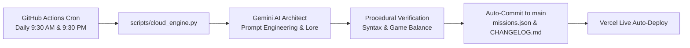

# CYBERHEIST // Neural Infiltration OS ⚡

A next-generation browser-based Cyberpunk Hacking Simulation Game and Neural Infiltration Terminal. Features dynamic terminal commands, quantum decryption matrices, active corporate trace mechanics, synthetic audio effects, and an **Autonomous Cloud Engine** powered by Google Gemini and GitHub Actions that procedurally expands missions and system nodes 24/7 without local machine dependency.

---

## 🎮 Key Features

- **Realistic Cyber Infiltration Terminal**: Execute authentic pentesting commands (`scan`, `nmap`, `crack`, `breach`, `trace-shield`).
- **Interactive System Topology**: Real-time visual feedback on compromised network nodes (Proxy, Firewall, Database, Core Vault).
- **Corporate Trace Meter**: Dynamic countdown and alert sirens if corporations trace your IP.
- **Native Web Audio Synthesizer**: Custom retro synthesized soundscapes with zero external audio dependencies.
- **Autonomous Cloud Architect**: GitHub Actions runs twice daily (`04:00 UTC` and `16:00 UTC`), generating new corporate targets and contracts using Gemini AI.
- **Mobile-Responsive Cyber HUD**: Fully playable on smartphones with built-in fast protocol touch macros.

---

## 💻 Command Protocols

| Command | Protocol Function |
|---|---|
| `help` | Display terminal command manual and available subroutines. |
| `missions` | Query active cyber heist contracts and reward telemetry. |
| `select <ID>` | Lock onto a contract target (e.g. `select M01`). |
| `scan` | Scan target proxy nodes and gather network reconnaissance. |
| `nmap` | Deep port probe to identify unshielded entry vectors. |
| `crack` | Execute cryptographic brute-force against corporate firewalls. |
| `breach` | Siphon the core data vault to complete the contract and extract bounties. |
| `trace-shield` | Scramble telemetry to reduce corporate counter-trace by 40%. |
| `clear` | Purge terminal buffer. |

---

## 🧠 Autonomous Architecture Loop

---

## 🛠️ Tech Stack

- **Frontend Core**: Vanilla HTML5, CSS3 (CRT Shader Overlay, Matrix Rain Canvas, Custom Monospace Grid).
- **Audio Synthesis**: Native Web Audio API (Oscillators, Gain Nodes, Ramp Curves).
- **State Management**: LocalStorage for persistent credits, EXP, and hacker rank.
- **Autonomous Pipeline**: Python 3.12, GitHub Actions, Google Gemini 2.5 API.

---

## 👨‍💻 Creator & Maintainer

**Mohammed Ahmed**  
*Full-Stack Software Engineer & System Architect*  
- Portfolio: [Lyceum OS](https://lyceumos-uitra-5vnp.vercel.app)  
- LinkedIn: [Mohammed Ahmed](https://linkedin.com/in/mohammed-ahmed-968886401/)  
- Kaggle: [mohammedtouffeq](https://kaggle.com/mohammedtouffeq)
